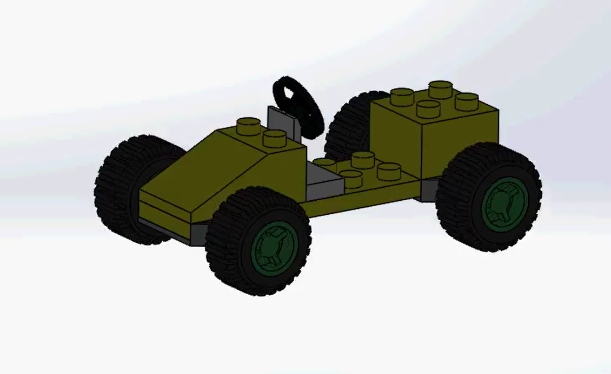
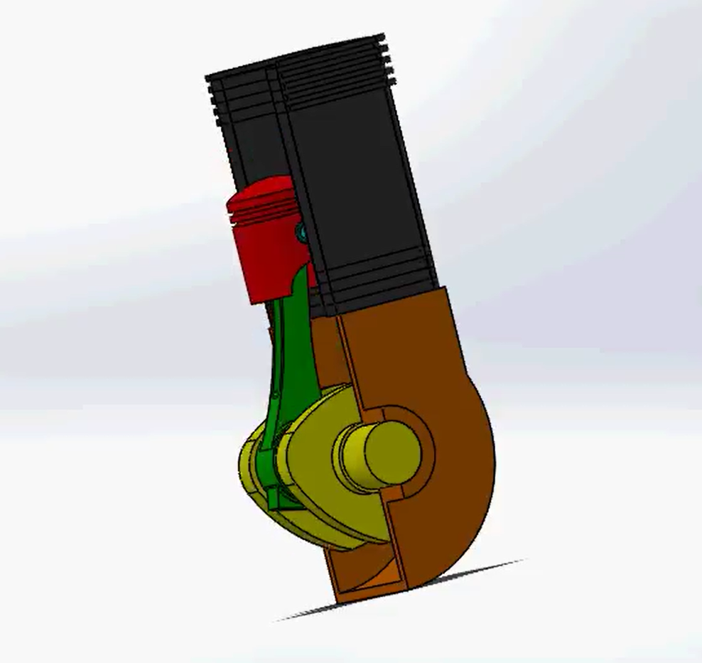
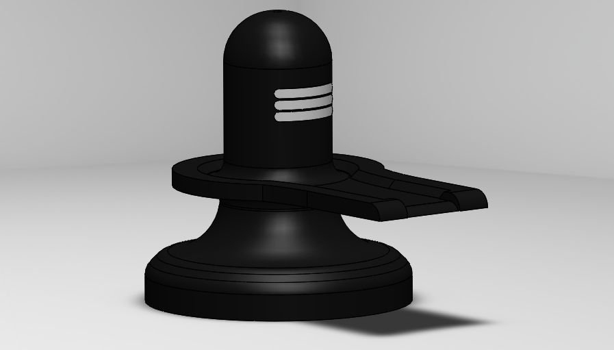

# 🛠️ My SolidWorks Designs

A collection of 3D CAD models designed in **SolidWorks**.
Click any image to watch the design video on YouTube.

---

## 🚗 1. Toy Car

A LEGO-style toy car assembly with a chassis, steering wheel, and four wheels.

▶️ [Watch on YouTube](https://youtu.be/_jAUb9eKQiI?si=8KMBlqvyQv8E94kn)

---

## ⚙️ 2. Single Cylinder Engine

A single cylinder engine assembly with a piston, connecting rod, crankshaft, and crankcase.

▶️ [Watch on YouTube](https://youtu.be/ty6IVKOSx6I?si=thkuoYU9v74krSDF)

---

## 🕉️ 3. Shiva Lingam

A 3D model of a Shiva Lingam with a base and the three-line Tripundra marking.

▶️ [Watch on YouTube](https://youtu.be/r40PT51zohc?si=IXQeKwwt3wEUztOc)

---

## 📺 YouTube Channel

[Subscribe here](https://www.youtube.com/@Geerthana_13)

## 👤 Author

**Your Name**
GitHub: [@GeerthanaVimal](https://github.com/GeerthanaVimal)
